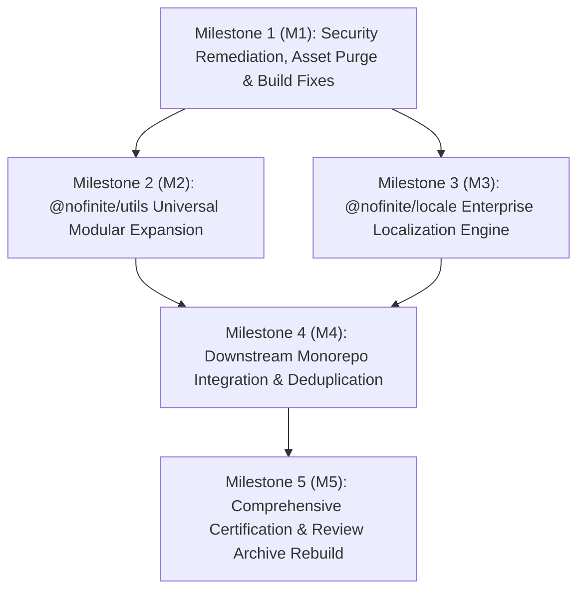

# Phase 5: Shared Foundations — Master Implementation Roadmap

**Programme:** Nofinite Engineering Quality Programme  
**Phase:** Phase 5 — Shared Foundations: Locale and Utils  
**Target Repository:** `D:\stack`  
**Packages:** `@nofinite/locale` (v2.0.0 -> v3.0.0), `@nofinite/utils` (v2.0.1 -> v3.0.0)  
**Governing Standard:** NEAS 1.0 (Nofinite Engineering Assurance Standard) / EOR 1.0  
**Author:** Antigravity Main Engineering Agent (Technical Assurance Lead)  
**Date:** November 6, 2026  
**Status:** Official Implementation Roadmap — Staged for Project Owner Authorization

---

## 1. Roadmap Architecture & Execution Principles

This roadmap defines the ordered implementation sequence to transform `@nofinite/locale` and `@nofinite/utils` into enterprise-grade shared foundations for the entire Nofinite ecosystem.

### Execution Principles:

- **Strict Stop-Gate Invariant:** Kickoff discovery is complete; zero code implementation occurs until explicit authorization from the Project Owner.
- **Ordered Dependency Chain:** Security fixes and architectural cleanups precede module additions; package refactoring precedes downstream monorepo consumer adoption.
- **Continuous Local Commits:** Compulsory local git commits after every working step (safety checkpoints).
- **Sole Committer Rule:** Main Agent is the sole git committer across repositories.
- **Independent Repositories:** Work is executed strictly within `D:\stack` and verified via `D:\ui-quality-lab`.

---

## 2. Milestone Sequence & Dependency Flow

---

## 3. Milestone Specifications

### Milestone 1 (M1): Security Remediation, Asset Purge & Build Pipeline Fixes

**Focus:** Immediate remediation of `UTILS-M3-01` and secondary security findings; Zero Downstream CSS compliance.  
**Estimated Complexity:** Medium (3 engineering days / 5 story points)  
**Dependencies:** None (Starts immediately upon Project Owner authorization).

#### Tasks & Deliverables:

1. **Resolve `UTILS-M3-01` (Native Fetch REST Client):**
   - Author `packages/utils/src/server/email/native-client.ts` implementing zero-dependency HTTP POST requests to Zoho ZeptoMail API (`/v1.1/email` and `/v1.1/email/batch`).
   - Implement `Authorization: Zoho-enczapikey <TOKEN>` protocol handling with secret token confidentiality guards.
   - Enforce server-only execution guard throwing immediately in browser environments (`window`/`document`).
   - Remove `"zeptomail"` from `packages/utils/package.json#dependencies` and remove pnpm root overrides.
2. **Remediate Secondary Security Findings:**
   - **`UTILS-SEC-01` (OTP Salt/HMAC):** Update `generateOtp` to return a 16-byte random salt alongside the hash; update `verifyOtp` to require salt and use constant-time comparison.
   - **`UTILS-SEC-02` (Argon2id Boundary & Timing):** Enforce 128-character maximum password length; add dummy verification for non-existent users.
   - **`UTILS-SEC-03` (JWT Secret Length):** Enforce RFC 7518 minimum 32-byte (256-bit) secret validation in `getJwtSecret`; pin verification algorithms to HMAC family.
3. **Zero Downstream CSS Purge (`@nofinite/locale`):**
   - Delete all 542 uncompiled SVG flag files from `packages/locale/src/flags/` (~3.9 MB).
   - Delete all 4 SCSS files from `packages/locale/src/styles/` and `scripts/generate-styles.ts`.
   - Retain `locale-style-shim` in `vite.config.ts` writing `@import '@nofinite/nuicss/styles.css';` for backward compatibility.
4. **Data Normalization (`packages/locale/src/data/countries.ts`):**
   - Fix Cayman Islands `dialCode` from `"+ 345"` to `"+345"`.
   - Fix Heard Island `dialCode` from `"+0"` to `"+672"`.
   - Normalize Åland Islands character encoding; add `iso3` and `currency` fields.
5. **Build Pipeline & Packaging Corrections:**
   - Fix `package.json#exports` in `@nofinite/utils` to include `"require"` for every subpath (resolves `ERR_REQUIRE_ESM`).
   - Fix `vite.config.ts` in `@nofinite/utils` from `dir: './packages/utils/dist'` to `dir: './dist'` (eliminates nested directory artifact).
   - Remove stale `packages/utils/dist/package.json`.

#### Exit Criteria (M1 Gate):

- `npm audit --omit=dev` yields 0 vulnerabilities in `@nofinite/utils`.
- `npm pack --dry-run` confirms 0 SVGs in `@nofinite/locale` and no nested folders in `@nofinite/utils`.
- All existing tests pass (Locale 86, Utils 38 = 124 passed).

---

### Milestone 2 (M2): `@nofinite/utils` Universal Modular Expansion (v3.0.0)

**Focus:** Implementing missing utility domains, universalizing UUID/OTP/JWT, and adopting `cn()`.  
**Estimated Complexity:** High (5 engineering days / 8 story points)  
**Dependencies:** Milestone 1 complete.

#### Tasks & Deliverables:

1. **Core Client Utility Domains:**
   - **`src/string/`:** `escapeHtml`, `unescapeHtml`, `sanitizeUrl`, `slugify`, `truncate`, `camelCase`, `snakeCase`, `kebabCase`, `pascalCase`, `capitalize`, `escapeRegex`, `template`.
   - **`src/object/`:** `deepClone` (structuredClone fallback), `deepMerge` (prototype pollution hardened), `pick`, `omit`, `isEqual`.
   - **`src/array/`:** `chunk`, `groupBy`, `unique`, `uniqueBy`, `shuffle` (Fisher-Yates CSPRNG), `partition`, `range`.
   - **`src/math/`:** `clamp`, `round` (precision-safe), `formatBytes`, `percentage`, `randomRange`.
   - **`src/async/`:** `debounce`, `throttle`, `sleep` (abortable), `retry` (exponential backoff), `timeout`, `pLimit`, `Deferred`.
   - **`src/validation/`:** `isEmail`, `isUrl`, `isNumeric`, `isPlainObject`, `isEmpty`, `isNil`.
   - **`src/date/`:** `date-math` (`addDays`, `subDays`, `diffDays`, `isSameDay`), `month-grid` (`generateMonthGrid`), `format-duration`.
   - **`src/dom/`:** `isBrowser`, `copyToClipboard`, `prefersReducedMotion`, `prefersDarkMode`, `safeLocalStorage`, `safeSessionStorage`.
2. **Adopt Class Name Merger (`src/cn/`):**
   - Implement canonical `cn(...inputs)` combining `clsx` and `tailwind-merge`. Fulfills documentation promise in `oss-docs` and `nofinite.com`.
3. **Universal Identifiers (`src/uuid/`):**
   - Implement zero-dependency RFC 9562 UUIDv7 and native `crypto.randomUUID()` UUIDv4.
   - Implement universal `uuidToBytes` and `bytesToUuid` using `Uint8Array`.
   - Remove `"uuid"` package from `package.json#dependencies`.
4. **Isolate Server Modules (`src/server/`):**
   - Contain `argon2` password hashing behind dynamic import in `src/server/password/`. Move `argon2` to optional peer dependencies.
   - Contain email dispatch behind `src/server/email/`.
   - Ensure root `@nofinite/utils` re-exports strictly isomorphic, zero-dependency utilities.

#### Exit Criteria (M2 Gate):

- Minimum 140 passing unit tests for `@nofinite/utils`.
- $\ge 95.0\%$ statement and branch coverage across all modules (`env` branch coverage $\ge 95\%$).
- Adversarial prototype pollution PoC test passes on `deepMerge`.
- Importing `@nofinite/utils` or subpaths in a browser Vite sandbox executes with 0 errors.

---

### Milestone 3 (M3): `@nofinite/locale` Enterprise Localization Engine (v3.0.0)

**Focus:** BCP 47 negotiation, zero-dependency translation engine, pluralization, and React bindings.  
**Estimated Complexity:** High (5 engineering days / 8 story points)  
**Dependencies:** Milestone 1 complete (can run in parallel with M2).

#### Tasks & Deliverables:

1. **Decouple Country Metadata (`src/data/`):**
   - Create subpath `@nofinite/locale/countries` exporting `countries`, `getCountryByCode`, `getCountryByDialCode`, `getCountriesByDialCode`, `getCountryMetadata`.
   - Implement $O(1)$ Map-indexed lookup for ISO codes and dial codes.
   - Re-export for backward compatibility from root index.
2. **BCP 47 & Language Negotiation (`src/bcp47/`):**
   - Implement `parseLocale(tag)` (decomposing language, script, region).
   - Implement `matchLocale(requested, supported, defaultLocale)` per RFC 4647.
   - Optimize `getDirection(locale)` with cached `Intl.Locale` evaluation.
3. **Advanced ECMAScript Formatters (`src/format/`):**
   - Implement `formatRelative(date, baseDate)` with automated threshold selection (`"just now"`, `"5 minutes ago"`).
   - Implement `formatDateRange(start, end, options, locale)`.
   - Implement `formatList(items, type, locale)` wrapping `Intl.ListFormat`.
   - Implement `getPluralCategory(count, options, locale)` wrapping `Intl.PluralRules`.
4. **Zero-Dependency Translation Catalog & Interpolation (`src/i18n/`):**
   - Implement `createTranslator(options)` supporting nested keys (`'auth.login.title'`).
   - Implement micro-template interpolation replacing `{param}` tokens.
   - Implement ICU message plural syntax support.
   - Implement asynchronous lazy-loading registry (`addCatalog`).
5. **Idiomatic React 18/19 Bindings (`src/react/`):**
   - Expand `<LocaleProvider>` to accept `messages`, `fallbackLocales`, and `syncHtmlAttributes` (`<html lang="..." dir="...">`).
   - Expand `useLocale()` to expose `direction`, `currency`, dynamic `setLocale()`, and all formatters.
   - Implement `useTranslation(namespace?)` hook exposing type-safe `t()` function.
6. **Server & Edge Helpers (`src/server/`):**
   - Implement `parseAcceptLanguage(header)` for SSR route handlers.

#### Exit Criteria (M3 Gate):

- Minimum 180 passing unit tests for `@nofinite/locale`.
- $\ge 95.0\%$ statement and branch coverage.
- Warm formatting latency $< 0.05\text{ ms/op}$ verified via automated benchmark.
- Core ESM bundle $< 15.0\text{ KB}$ raw / $< 5.0\text{ KB}$ gzip verified.

---

### Milestone 4 (M4): Downstream Monorepo Integration & Deduplication

**Focus:** Migrating downstream libraries to consume shared foundations; eliminating duplicate utility code.  
**Estimated Complexity:** Medium (4 engineering days / 5 story points)  
**Dependencies:** Milestones 2 and 3 complete.

#### Tasks & Deliverables:

1. **NUI (`@nofinite/nui`):**
   - Re-export or consume `cn` from `@nofinite/utils/cn`.
   - Replace manual min/max clamping in `Slider`, `Progress`, and `VirtualList` with `@nofinite/utils/math` (`clamp`).
2. **Nofinite Charts (`@nofinite/charts`):**
   - Replace hand-rolled `formatMetricNumber` and `toLocaleDateString` in `axis.ts` and `tooltip.ts` with `@nofinite/locale` formatters.
   - Adopt `@nofinite/utils/async` (`debounce`, `throttle`) for resize listeners.
   - Adopt `@nofinite/utils/string` (`escapeHtml`) for SVG title/label rendering.
3. **Nofinite Kanban (`@nofinite/kanban`):**
   - Adopt `@nofinite/utils/uuid` (`generateUuidV7`) for auto-assigned card/column IDs.
   - Adopt `@nofinite/locale` (`formatRelative`) for card activity timestamps.
   - Adopt `@nofinite/utils/math` (`clamp`) for drag-and-drop boundary math.
4. **Nofinite Markon (`@nofinite/markon`):**
   - Replace internal `escapeHtml`, `sanitizeUrl`, and slug generation with `@nofinite/utils/string`.
   - Adopt `@nofinite/utils/async` (`debounce`) in `draftManager.ts`.
5. **NUIX (`@nofinite/nuix`):**
   - Replace external `@formkit/tempo` in `src/utils/date-math.ts` with `@nofinite/utils/date` (`addDays`, `generateMonthGrid`), shrinking the NUIX CDN bundle.
   - Align `src/utils/escape.ts` with `@nofinite/utils/string`.
6. **Documentation Platforms (`oss-docs` & `nofinite.com`):**
   - Verify `cn()` imports in `oss-docs` resolve directly to `@nofinite/utils`.
   - Eliminate duplicate local copies of `clsx` and `tailwind-merge` where appropriate.

#### Exit Criteria (M4 Gate):

- All downstream test suites pass 100% (Charts 52, Kanban 44, Markon 74, Media 40, NUI 71, NUIX 454).
- Zero regressions in existing component rendering or user interaction.

---

### Milestone 5 (M5): Comprehensive Certification & Review Archive Rebuild

**Focus:** Full NEAS 1.0 Level 2 certification, multi-runtime browser testing, and canonical rolling archive rebuild.  
**Estimated Complexity:** Medium (2 engineering days / 3 story points)  
**Dependencies:** Milestone 4 complete.

#### Tasks & Deliverables:

1. **Quality Platform Verification (`D:\ui-quality-lab`):**
   - Execute clean package tarball consumer verification in `fixtures/consumer-sandbox/`.
   - Run multi-browser Playwright sweeps (Chromium, Firefox, WebKit) on React and Vanilla sandboxes.
   - Verify zero hydration mismatch warnings in React 19 SSR scenarios.
2. **Audit & SBOM Generation:**
   - Execute production dependency audits (`pnpm audit --prod`) asserting 0 vulnerabilities across both packages.
   - Generate updated CycloneDX 1.5 and SPDX 2.3 Software Bills of Materials for `@nofinite/locale@3.0.0` and `@nofinite/utils@3.0.0`.
3. **Rebuild Canonical Rolling Review Archive (`report.zip`):**
   - In strict compliance with EOR 1.0 Section 8, rebuild `D:\ui-quality-lab\ai-docs\report.zip` incorporating Phase 5 deliverables, execution reports, patches, and logs.
   - Verify `zipfile.testzip()` (0 CRC errors) and 100% `MANIFEST.sha256` matching.

#### Exit Criteria (M5 Gate):

- All 14 Phase 5 Certification Gates (`GATE-P5-01` through `GATE-P5-14`) verified and documented.
- Formal Phase 5 Quality Certification Report authored and signed off.

---

## 4. Summary Schedule & Resource Estimates

| Milestone | Target Scope                                      |  Duration   | Complexity | Primary Gate                                                  |
| :-------- | :------------------------------------------------ | :---------: | :--------: | :------------------------------------------------------------ |
| **M1**    | Security Remediation, Asset Purge & Build Fixes   |   3 days    |   Medium   | `UTILS-M3-01` eliminated; 0 CVEs; 0 SVGs in locale            |
| **M2**    | `@nofinite/utils` Universal Modular Expansion     |   5 days    |    High    | $\ge 140$ tests; $\ge 95\%$ coverage; client isomorphism      |
| **M3**    | `@nofinite/locale` Enterprise Localization Engine |   5 days    |    High    | $\ge 180$ tests; $\ge 95\%$ coverage; bundle $< 15\text{ KB}$ |
| **M4**    | Downstream Monorepo Integration & Deduplication   |   4 days    |   Medium   | Zero regressions across Stack, NUIX, and Docs                 |
| **M5**    | Quality Certification & Archive Rebuild           |   2 days    |   Medium   | 14 gates passed; canonical `report.zip` ratified              |
| **TOTAL** | **Phase 5 Full Implementation Programme**         | **19 days** |  **High**  | **Phase 5 Level 2 Release Assurance Certification**           |

---

## 5. Risk Management & Mitigation Invariants

1. **Risk: `argon2` Cross-Platform Compilation Breakage**  
   _Mitigation:_ `argon2` is strictly an optional peer dependency isolated inside `@nofinite/utils/server`. It is never loaded by root or client utilities.
2. **Risk: Downstream Breaking Changes in `formatCurrency`**  
   _Mitigation:_ `formatCurrency` supports both positional arguments `(amount, currency, options, locale)` and options object `(amount, { currency, locale })`, ensuring 100% backward compatibility.
3. **Risk: Legacy CSS Import 404 Errors**  
   _Mitigation:_ The Vite build plugin `locale-style-shim` is permanently retained to emit `dist/style.css` containing `@import '@nofinite/nuicss/styles.css';`.
4. **Risk: Scope Expansion during M4 Integration**  
   _Mitigation:_ Downstream package updates are strictly limited to replacing duplicate internal utility functions with `@nofinite/utils` and `@nofinite/locale`. No component API changes or feature additions are permitted.

This implementation roadmap establishes a precise, risk-controlled path to executing Phase 5 upon Project Owner authorization.
