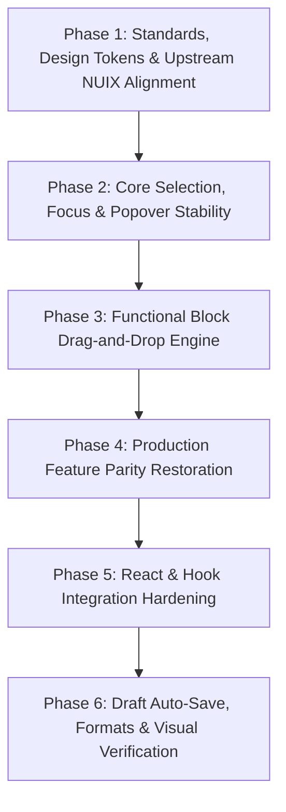

# Comprehensive Phased Implementation Plan: Production-Grade `@nofinite/markon`

## Objective

Elevate `@nofinite/markon` into an enterprise-grade, framework-agnostic content authoring engine that strictly adheres to the Nofinite ecosystem constitution ([`@nofinite/nuicss`](file:///d:/stack/packages/nuicss) design tokens & [`@nofinite/nuix`](file:///d:/nuix) headless architecture), fixes all subtle vanilla DOM selection and event lifecycle bugs, restores 100% of the rich features originally present in the React version, and provides a flawless React wrapper without cursor jumping or stale props.

---

## Phased Execution Roadmap

Execution is structured into 6 sequential, fully focused phases. Each phase will be executed independently and will only proceed upon explicit user confirmation ("next").

---

### Phase 1: Standards, Design Tokens & Upstream NUIX Alignment

**Focus:** Purge hardcoded styles, eliminate design system violations, enforce the modal contract, and align with `@nofinite/nuix` and `@nofinite/nuicss`.

- **1.1 Design Token & CSS Cleanup:**
  - Replace all hardcoded hex literals in `packages/markon/src/core/toolbarMenus.ts` (`HIGHLIGHT_PRESETS` and `TEXT_COLOR_PRESETS`) with semantic NUICSS design tokens (`var(--color-primary)`, `var(--color-warning)`, `var(--color-danger)`, `var(--color-success)`, `var(--color-neutral)`, etc.) and OKLCH palettes.
  - Eliminate hardcoded theme classes in `packages/markon/src/core/extensions.ts` line 193 (`bg-slate-900 text-slate-50`). Replace with theme-adaptive NUICSS tokens (`bg-subtle text-default border border-default`).
  - Purge arbitrary Tailwind bracket utilities (`text-[10px]`, `text-[11px]`) across `bubbleMenu.ts`, `slashCommand.ts`, and `toolbarMenus.ts`, replacing them with semantic typography scales (`text-xs`).
- **1.2 Strict Modal Hierarchy & Backdrop Contract (`dialog.ts`):**
  - Comply with the constitution rule: Remove the ambiguous corner `✕` close button from confirmation/edit modals containing explicit "Cancel" and "Save" action buttons.
  - Enforce glassmorphic backdrop styling (`backdrop:bg-overlay backdrop:backdrop-blur-sm`) on native `<dialog class="modal">` elements instead of inline transparent workarounds.
- **1.3 Upstream NUIX Component Integration:**
  - Introduce `@nofinite/nuix` as a dependency in `packages/markon/package.json`.
  - Harmonize modal and popover DOM structures with NUIX superclasses (`modal-box`, `modal-footer`, `dropdown`, `popover`).

---

### Phase 2: Core Selection, Focus & Popover Stability (Subtle Bug Remediation)

**Focus:** Eliminate ProseMirror selection loss, scroll disconnects, popover race conditions, and module singleton leaks.

- **2.1 Modal Selection & Focus Preservation:**
  - In `MarkonEditor.ts` and `dialog.ts`, capture the active ProseMirror selection range (`editor.state.selection`) _prior_ to displaying any modal input (Link, Image, Math).
  - When the modal confirms, restore the exact selection range before dispatching TipTap command transactions (`setLink`, `setImage`, `insertContent`), preventing collapsed or misplaced formatting.
- **2.2 Bubble Menu Floating UI Auto-Update:**
  - In `packages/markon/src/core/bubbleMenu.ts`, connect `@floating-ui/dom`'s `autoUpdate` to track window scrolling and container scrolling (`.editor-content`).
  - Safely unregister `autoUpdate` on selection collapse and editor destruction.
  - Replace raw emoji icons (e.g. `🔗`) with crisp SVG icons matching NUIX design standards.
- **2.3 Slash Command Instance Encapsulation:**
  - Refactor `packages/markon/src/core/slashCommand.ts` to remove module-level singleton state (`popupEl`, `selectedIndex`, `currentItems`).
  - Encapsulate popup state per extension/editor instance so multiple editors on the same page operate without collision or cross-contamination.
- **2.4 Unified Popover Manager & Outside Click Safety:**
  - Consolidate the 5 popover menu classes (`Typography`, `FontFamily`, `FontSize`, `Highlight`, `TextColor`) to use a shared popover lifecycle helper.
  - Automatically close any open popover when a new one opens, eliminating concurrent z-index fights and document event listener leaks.

---

### Phase 3: Functional Block Drag-and-Drop Engine

**Focus:** Transform the cosmetic drag handle into a true Notion-style block reordering and manipulation system.

- **3.1 Safe ProseMirror Node Resolution:**
  - In `packages/markon/src/core/dragHandle.ts`, fix the `resolved.before(1)` crash when resolving positions at root depth 0 or inside nested nodes.
- **3.2 Complete Drag-and-Drop Lifecycle:**
  - Implement `dragover`, `dragenter`, `dragleave`, and `drop` event listeners on the editor container.
  - Calculate target block drop coordinates accurately using ProseMirror's `posAtCoords`.
- **3.3 Visual Drop Indicator:**
  - Render an animated drop insertion indicator line between blocks showing precisely where the dropped block will land.
- **3.4 Atomic Node Movement Transaction:**
  - On `drop`, execute a clean atomic ProseMirror transaction (`tr.delete(sourcePos, sourcePos + nodeSize).insert(targetPos, node)`), preserving selection and node attributes.

---

### Phase 4: Production Feature Parity Restoration

**Focus:** Port back and modernize all rich content authoring features from the previous React implementation (`packages/nui/src/components/editor/`).

- **4.1 Interactive Table Dimension Picker:**
  - Replace the rigid "3x3 Table" button with an interactive grid picker (hover over rows/columns up to 10x10 to choose table size dynamically before inserting).
- **4.2 Video & Media Embed Engine:**
  - Implement a framework-agnostic `CustomVideo` TipTap extension supporting YouTube, Vimeo, and direct video URLs (`.mp4`, `.webm`) with responsive aspect ratios.
- **4.3 Resizable & Alignable Image NodeView:**
  - Create a custom DOM NodeView for images featuring corner drag resize handles, width percentage controls, and alignment tools (left, center, right).
- **4.4 Enhanced Code Block NodeView:**
  - Create an interactive Code Block NodeView equipped with syntax language selector dropdown (TypeScript, JavaScript, Python, HTML, CSS, JSON, etc.) and a one-click "Copy Code" button with toast notification.
- **4.5 Collapsible / Accordion Sections:**
  - Re-introduce toggle headings / collapsible accordion blocks (Notion-style `
` / `
` blocks).
- **4.6 File Attachments & Drag-and-Drop File Upload:**
  - Add file attachment block with icon, filename, filesize, and download action.
  - Support `onUploadFile?: (file: File) => Promise<string>` hook to upload dropped images and files asynchronously rather than forcing multi-megabyte Base64 strings.

---

### Phase 5: React & Hook Integration Hardening (`MarkonEditor.tsx` & `useMarkon.ts`)

**Focus:** Guarantee seamless, flicker-free, and cursor-stable integration in modern React / Next.js environments.

- **5.1 Dynamic Props Reactivity (No Stale Closures):**
  - Update `packages/markon/src/react/MarkonEditor.tsx` to reactively synchronize updates to `readOnly`, `placeholder`, `minHeight`, and toolbar flags without tearing down and re-instantiating the editor.
- **5.2 Non-Destructive Controlled Content Sync (Eliminate Cursor Jumping):**
  - Prevent caret jumping to index 0 on parent re-renders by performing diff-checks before dispatching transactions and preserving ProseMirror cursor coordinates when syncing incoming `value`.
- **5.3 Reactive `useMarkon` Hook Statistics:**
  - Ensure `wordCount`, `charCount`, and `isEmpty` update on both user input and programmatic `setContent()` calls.

---

### Phase 6: Draft Auto-Save, Bidirectional Formats & Visual Verification

**Focus:** Enterprise persistence, export formats, automated testing, and Playwright visual validation.

- **6.1 Real Auto-Save & Crash Recovery:**
  - Implement local storage / IndexedDB draft manager with active save states: `saving`, `saved`, `error`, and last-saved timestamp.
  - Wire the status footer to show live saving indicators.
- **6.2 Serialization & Clean Output:**
  - Add bidirectional Markdown parsing and export utilities.
- **6.3 Comprehensive Verification & Playwright Visual Testing:**
  - Expand `packages/markon/src/markon.test.ts` to cover all new extensions, commands, and selection restoration.
  - Run Playwright visual tests capturing screenshots in `/temp/screenshots/` to verify spatial layout, popover alignments, and modal backdrop blur.
  - Run `npm pack` in `packages/markon` to verify compiled distribution tarball integrity.

---

## Dependencies & Affected Files

### Modified Packages:

- `packages/markon`: Primary engine refactor and extension enhancements.
- `packages/nuicss`: Upstream token and mark/sub/sup style definitions.

### Key Files Affected:

- `packages/markon/package.json`
- `packages/markon/src/core/MarkonEditor.ts`
- `packages/markon/src/core/dialog.ts`
- `packages/markon/src/core/bubbleMenu.ts`
- `packages/markon/src/core/slashCommand.ts`
- `packages/markon/src/core/dragHandle.ts`
- `packages/markon/src/core/toolbarMenus.ts`
- `packages/markon/src/core/typographyMenu.ts`
- `packages/markon/src/core/extensions.ts`
- `packages/markon/src/react/MarkonEditor.tsx`
- `packages/markon/src/react/useMarkon.ts`
- `packages/nuicss/src/styles/theme.css`

---

## Risks & Mitigations

| Risk                                                    | Mitigation                                                                                                             |
| :------------------------------------------------------ | :--------------------------------------------------------------------------------------------------------------------- |
| **Selection loss during modal or popover interactions** | Explicitly cache `editor.state.selection` before opening overlays, and restore it before dispatching commands.         |
| **Cursor jumping in controlled React forms**            | Perform DOM/JSON equality checks and use transaction mapping instead of full `setContent` resets.                      |
| **DOM bloat from multiple Floating UI instances**       | Implement a shared popover manager that enforces a single active popover and registers `autoUpdate` only when visible. |
| **CSS token divergence**                                | Strictly bind all colors and surfaces to `@nofinite/nuicss` variables; zero hardcoded hex literals.                    |

---

## Verification Strategy

1. **Unit & Integration Tests:** Vitest test suite covering node creation, selection state, and command execution.
2. **Visual Verification:** Playwright screenshots saved to `/temp/screenshots/` to verify aesthetics, drop indicators, and glassmorphic backdrops.
3. **NPM Output Verification:** Run `npm pack` to inspect tarball contents and ensure all type declarations and bundles are present.
4. **Local Git Commits:** Compulsory logical commit following successful verification of each phase.
