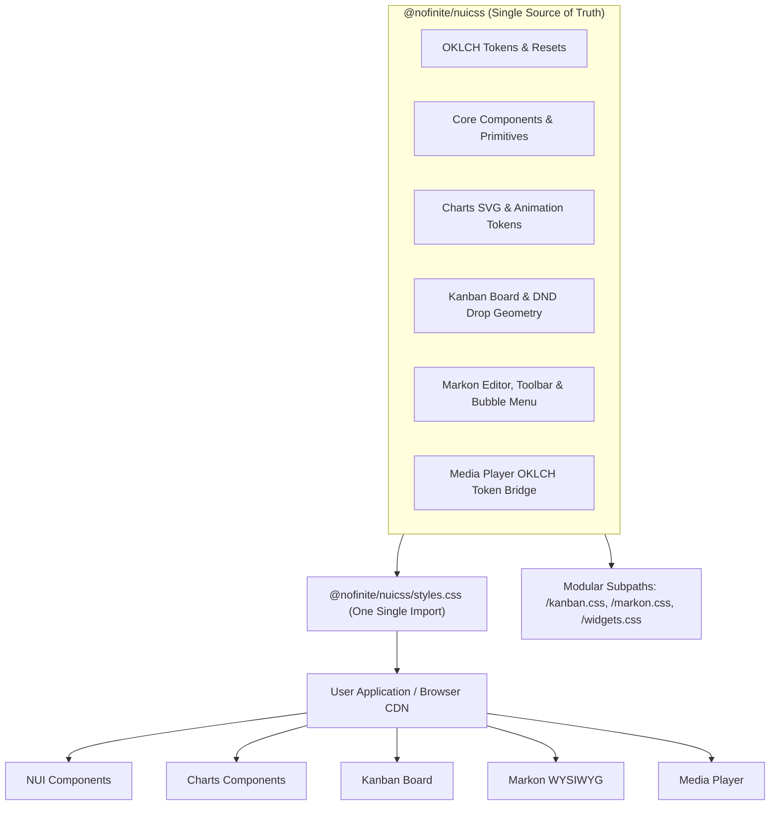

# Implementation Plan: Unification of Ecosystem Styles into `@nofinite/nuicss`

## Executive Summary

This implementation plan resolves the multi-stylesheet fragmentation ("dual-track styling") across `@nofinite/charts`, `@nofinite/kanban`, `@nofinite/markon`, and `@nofinite/media`. It establishes `@nofinite/nuicss` as the single source of truth and single required stylesheet for the entire Nofinite ecosystem, eliminating import fatigue, cascade conflicts, and bundle duplication.

---

## 1. Problem Statement & Root Cause Analysis

### Current Behavior

Currently, developers installing packages across the ecosystem must configure multiple separate stylesheets:

- `@nofinite/nuicss/styles.css` (Base tokens & core superclasses)
- `@nofinite/kanban/styles.css` (10.4 kB board & drag-and-drop layout)
- `@nofinite/markon/styles.css` (10.8 kB editor chrome & bubble menu)
- `@nofinite/media/styles.css` (74.4 kB player layout & Vidstack styles)
- `@nofinite/charts/styles.css` (196.9 kB duplicate copy of NUICSS)

### Why Each Package Currently Has Its Own File

1. **Charts:** Contains **0 lines** of custom CSS in `src/`. Its `src/styles.ts` literally imports `@nofinite/nuicss/styles.css`, causing Vite to bundle a redundant 196.9 kB duplicate of the entire NUICSS stylesheet.
2. **Markon:** Originally built as a standalone TipTap editor. About 65% of its styles (canvas typography, task lists, markdown tables, headings) are already baked into NUICSS (`packages/nuicss/src/styles/theme.css` Section 6), but ~150 lines for toolbar, footer, and floating bubble menu were left in `markon.css`.
3. **Kanban:** NUICSS only defines 3 minimal shortcuts in `widgets.ts` (`kanban-board`, `kanban-column`, `kanban-card`). The remaining 450 lines of drag-and-drop interaction geometry (drop indicators, dragging state, card lists, WIP limit badges) were placed inside `kanban/src/styles.css`, even though all 450 lines strictly consume NUICSS tokens.
4. **Media:** Media has 7.4 kB of NUICSS token mappings, but 67 kB of external layout CSS from the `vidstack` npm package (`theme.css`, `video.css`, `audio.css`).

### Architectural Hazards of the Current Setup

- **Import Fatigue:** Developers must maintain up to 5 distinct stylesheet imports in their root layout.
- **Silent Broken States:** If a developer forgets to import `@nofinite/kanban/styles.css` or `@nofinite/markon/styles.css`, components render completely unstyled or visually collapsed without build-time errors.
- **Cascade & Specificity Wars:** If a user or bundler imports `@nofinite/kanban/styles.css` before `@nofinite/nuicss/styles.css`, CSS `@layer` rules and token overrides can clash or behave unpredictably.
- **Severe Bloat:** Importing `@nofinite/charts/styles.css` injects an extra 196 kB stylesheet that duplicates NUICSS.

---

## 2. Industry Standards & Architectural Comparison

| Architecture                                          | Examples                                                                                           | Pros                                                                                                                            | Cons                                                                                 | Ecosystem Verdict                                 |
| :---------------------------------------------------- | :------------------------------------------------------------------------------------------------- | :------------------------------------------------------------------------------------------------------------------------------ | :----------------------------------------------------------------------------------- | :------------------------------------------------ |
| **Model A: Multi-Stylesheet Per Package**             | Mantine v7 (`@mantine/core/styles.css`, `@mantine/dates/styles.css`, `@mantine/charts/styles.css`) | Modular per package                                                                                                             | Extreme import fatigue; broken rendering on forgotten imports; cascade ordering bugs | ❌ **Rejected** (Current flawed state)            |
| **Model B: Runtime / CSS-in-JS Injection**            | Emotion, Styled Components, StyleX                                                                 | Zero manual CSS imports                                                                                                         | SSR hydration mismatches; CSP unsafe-inline blocks; runtime performance penalty      | ❌ **Rejected** (Violates zero-runtime principle) |
| **Model C: Unified Ecosystem Engine** _(Recommended)_ | Radix Themes, NextUI (HeroUI), Ant Design, Tailwind UI                                             | **Single `@import` styles entire ecosystem**; zero duplicate stylesheets; consistent tokens; optional subpaths for tree-shakers | Requires consolidating component layout rules into the design token compiler         | ✅ **Chosen Industry Standard**                   |

### Proposed Ecosystem Invariant:

> **One Import to Rule Them All:** Loading `@nofinite/nuicss/styles.css` (or CDN link) MUST provide all styles, tokens, and layout classes needed by NUI, Charts, Kanban, and Markon. No secondary stylesheets required.

---

## 3. Proposed Solution & Architecture

### Strategy Per Package:

1. **Charts:**
   - Eliminate `charts/src/styles.ts` and stop emitting `charts/dist/styles.css`.
   - Charts SVG animations and token variables already reside in NUICSS (`theme.css` Section 15.b).
   - Package export `./styles.css` in `packages/charts/package.json` will either be deprecated or aliased to `@nofinite/nuicss/styles.css` for backward compatibility.
2. **Kanban:**
   - Migrate all 455 lines of Kanban layout and drag-and-drop indicators from `packages/kanban/src/styles.css` into NUICSS (`packages/nuicss/src/styles/theme.css` or dedicated layered component module).
   - Export `@nofinite/nuicss/kanban.css` from NUICSS for modular consumers.
   - Kanban consumers only need `@nofinite/nuicss/styles.css`.
   - Keep a backward-compatibility re-export in `packages/kanban` so legacy apps don't crash on import.
3. **Markon:**
   - Migrate the remaining ~150 lines (toolbar, footer, floating bubble menu pill) from `packages/markon/src/styles/markon.css` into NUICSS `packages/nuicss/src/styles/theme.css` (joining existing Section 6 TipTap styles).
   - Export `@nofinite/nuicss/markon.css` (and existing `dist/tiptap.css`) from NUICSS for modular consumers.
   - Markon consumers only need `@nofinite/nuicss/styles.css`.
   - Keep a backward-compatibility re-export in `packages/markon`.
4. **Media:**
   - Ensure the 7.4 kB NUICSS OKLCH token bridge is compiled into NUICSS.
   - For the 67 kB Vidstack layout chrome, maintain `@nofinite/media/styles.css` (or auto-inject via component) so users without video players do not pay a 67 kB video layout penalty in standard dashboards, but ensure all brand/token colors cascade seamlessly from NUICSS.

---

## 4. Phased Implementation Roadmap

### Phase 1: Charts Single-NUICSS Migration

- Remove `entry.styles` from `packages/charts/vite.config.ts`.
- Remove `packages/charts/src/styles.ts`.
- In `packages/charts/package.json`, point `./styles.css` to `@nofinite/nuicss/styles.css` (preventing breaking changes for existing consumers while eliminating the 196 kB duplicate file).
- Rebuild Charts and verify package tarball via `npm pack --dry-run`.

### Phase 2: Kanban Layout Migration to NUICSS

- Port the 455 lines of `.kanban-*` layout, drop-indicators, and interaction classes from `packages/kanban/src/styles.css` into NUICSS `packages/nuicss/src/styles/theme.css` (Section 15.c: KANBAN TASK BOARD & DND LAYOUT).
- Update `packages/nuicss/build-cdn.js` and package exports to emit `dist/kanban.css` as a dedicated modular subpath.
- Update `packages/kanban/package.json` `./styles.css` export to alias the NUICSS kanban stylesheet or keep a thin shim.
- Rebuild NUICSS and Kanban; verify that Kanban boards render 100% styled when ONLY `@nofinite/nuicss/styles.css` is imported.

### Phase 3: Markon Toolbar & Bubble Menu Migration to NUICSS

- Port the remaining ~150 lines (toolbar, footer, and `.markon-bubble-menu`) from `packages/markon/src/styles/markon.css` into NUICSS `packages/nuicss/src/styles/theme.css` Section 6.
- Update `packages/nuicss/build-cdn.js` to ensure all Markon classes are included in `dist/styles.css` and `dist/tiptap.css`.
- Update `packages/markon/package.json` `./styles.css` export to alias NUICSS or provide a thin shim.
- Rebuild NUICSS and Markon; verify that Markon editors and bubble menus render 100% styled when ONLY `@nofinite/nuicss/styles.css` is imported.

### Phase 4: Media Token Realignment & Documentation Updates

- Verify that NUICSS contains all media tokens and player variables.
- Update Quick Start guides across all packages:
  - Clearly state that `@nofinite/nuicss/styles.css` is the **sole required stylesheet** for NUI, Charts, Kanban, and Markon.
  - Remove all instructions telling users to import separate `@nofinite/charts/styles.css`, `@nofinite/kanban/styles.css`, and `@nofinite/markon/styles.css`.

### Phase 5: Verification & Packaging Validation

- Run unit tests across all affected packages (`charts`, `kanban`, `markon`, `media`, `nuicss`).
- Run `npm pack` across all packages to inspect compiled tarball contents.
- Visual verification: Render sample pages for Kanban, Markon, and Charts with **only** NUICSS loaded to visually prove zero regressions in layout, drop indicators, and bubble menus.

---

## 5. Affected Files & Modules

| File                                   | Action     | Description                                                                |
| :------------------------------------- | :--------- | :------------------------------------------------------------------------- |
| `packages/nuicss/src/styles/theme.css` | **Modify** | Add Kanban board/DND layout classes and Markon toolbar/bubble menu classes |
| `packages/nuicss/build-cdn.js`         | **Modify** | Add `dist/kanban.css` and enhanced `dist/tiptap.css` subpath bundles       |
| `packages/nuicss/package.json`         | **Modify** | Add `./kanban.css` export to `exports`                                     |
| `packages/charts/vite.config.ts`       | **Modify** | Remove redundant `styles.ts` entry                                         |
| `packages/charts/src/styles.ts`        | **Delete** | Remove redundant NUICSS re-import file                                     |
| `packages/charts/package.json`         | **Modify** | Update/alias `./styles.css`                                                |
| `packages/charts/README.md`            | **Modify** | Clarify that only NUICSS stylesheet is required                            |
| `packages/kanban/package.json`         | **Modify** | Provide shim/alias for `./styles.css`                                      |
| `packages/kanban/README.md`            | **Modify** | Remove dual-track stylesheet requirement                                   |
| `packages/markon/package.json`         | **Modify** | Provide shim/alias for `./styles.css`                                      |
| `packages/markon/README.md`            | **Modify** | Remove dual-track stylesheet requirement                                   |

---

## 6. Risk Assessment & Mitigations

- **Risk: Breaking Existing Projects that Import `@nofinite/kanban/styles.css` or `@nofinite/markon/styles.css`:**
  - _Mitigation:_ Preserve `./styles.css` export in `package.json` as a thin shim or re-export of the NUICSS styles. No import error will occur for existing users.
- **Risk: CSS Specificity Collision:**
  - _Mitigation:_ All migrated styles will be wrapped in `@layer components { ... }` inside NUICSS, ensuring strict cascade layering order (base -> components -> utilities).
- **Risk: Bundle Size Inflation of Core NUICSS:**
  - _Mitigation:_ Kanban layout is ~10 kB unminified (~2.5 kB gzipped); Markon toolbar is ~4 kB unminified (~1 kB gzipped). Adding ~3.5 kB gzipped to NUICSS eliminates over 200 kB of duplicate stylesheets across the ecosystem and enables modular subpath imports (`@nofinite/nuicss/kanban.css`) for tree-shaking.

---

## 7. Verification Strategy

1. **Compilation Check:** Run `pnpm nx run-many -t build -p nuicss charts kanban markon` to verify error-free build.
2. **NPM Package Verification:** Run `npm pack --dry-run` in each package directory and inspect the tarball contents to confirm all expected files are present and no empty folders exist.
3. **Automated Unit Tests:** Run test suites across `nuicss`, `charts`, `kanban`, `markon`.
4. **Visual Inspection:** Create test HTML harness in `/temp/` loading **only** `@nofinite/nuicss/dist/styles.css` with a Kanban board, Markon editor, and Chart, verifying full layout correctness, drop indicator styling, and glassmorphic aesthetics.
