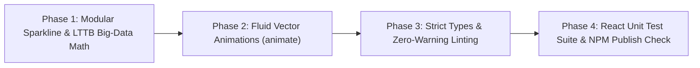

# Phased Implementation Plan: 100% Production Excellence for `@nofinite/charts`

## Overview & Execution Strategy

To ensure deep focus, mathematical precision, and zero regressions, the remaining 4% is structured into 4 sequential phases. We will execute **Phase 1** first, verify it completely, commit it, and wait for your explicit `"next"` before touching subsequent phases.

---

## Phase 1: Modular Architecture & Big-Data Engine (LTTB) [CURRENT FOCUS]

### 1. Objective

1. **Extract Dedicated Sparkline**: Decouple `<Sparkline />` out of `ScatterChart.tsx` into a standalone, tree-shakeable component file [`packages/charts/src/react/Sparkline.tsx`](file:///D:/stack/packages/charts/src/react/Sparkline.tsx).
2. **LTTB Downsampling Algorithm**: Implement the **Largest Triangle Three Buckets (LTTB)** algorithm in `math.ts` to allow 5,000–50,000+ data point sets to downsample down to 300–500 points with $O(N)$ linear speed while mathematically preserving all visual peaks, troughs, and curve shape.
3. **Wire `downsampleThreshold?: number`**: Add optional prop to `LineChartProps`, `AreaChartProps`, and `ScatterChartProps` so massive telemetry datasets render at a locked 60fps without SVG DOM freezing.
4. **Verification**: Verify mathematical correctness and ensure `pnpm nx build charts` and unit tests pass.

### 2. Affected Files

- `packages/charts/src/react/Sparkline.tsx` (New)
- `packages/charts/src/react/ScatterChart.tsx` (Remove Sparkline implementation, re-export for backward compatibility)
- `packages/charts/src/react/index.ts` (Export `Sparkline` and `SparklineProps`)
- `packages/charts/src/core/math.ts` (Implement `downsampleLTTB` and export)
- `packages/charts/src/core/index.ts` (Export `downsampleLTTB`)
- `packages/charts/src/react/LineChart.tsx` (Add `downsampleThreshold` support)
- `packages/charts/src/react/AreaChart.tsx` (Add `downsampleThreshold` support)
- `packages/charts/src/react/ScatterChart.tsx` (Add `downsampleThreshold` support)
- `packages/charts/src/charts.test.ts` (Add unit tests for LTTB math downsampling)

---

## Phase 2: Zero-Dependency Fluid Entrance Animations [STANDBY]

### 1. Objective

- Add lightweight CSS keyframe transitions and SVG stroke-dashoffset drawing for line and area paths.
- Add `animate?: boolean` (default `true`) across `LineChart`, `AreaChart`, and `BarChart`.
- Respect `prefers-reduced-motion: reduce` natively.

---

## Phase 3: Type Strictness & Zero-Warning Linting [STANDBY]

### 1. Objective

- Replace all non-null assertions (`!`) in `math.ts` with safe null-coalescing (`?? 0`).
- Refine generic accessors and D3 scale typing in `math.ts` and `normalize.ts`.
- Run `pnpm nx lint charts` to eliminate warnings and ensure clean strictness.

---

## Phase 4: Comprehensive React Test Suite & NPM Publish Readiness [STANDBY]

### 1. Objective

- Create `packages/charts/src/react/charts.react.test.tsx` testing all React components with happy-dom.
- Test empty array `[]` resilience, single-point sets, accessibility table generation, and legend toggle callbacks.
- Final `npm pack --dry-run` and release readiness sign-off.
