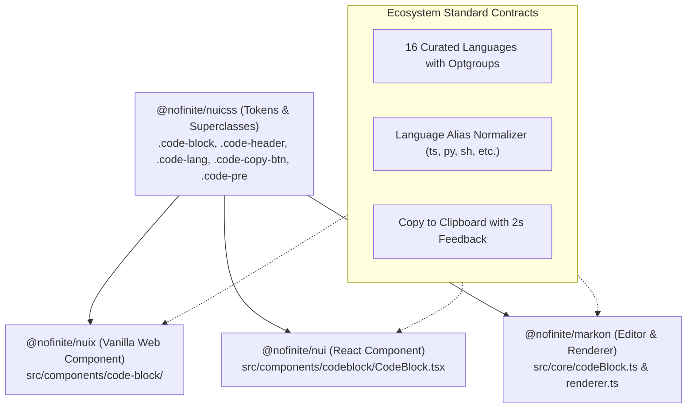

# Implementation Plan: Ecosystem-Wide CodeBlock Harmonization & Markon Toolbar, Drag & Media Glitch Fixes

**Document Version:** 2.0.0  
**Affected Repositories & Packages:**

- **Repository 1:** `d:\nuix` (`@nofinite/nuix`)
- **Repository 2:** `d:\stack` (`@nofinite/nui`, `@nofinite/markon`, `@nofinite/nuicss`)

---

## 1. Executive Summary & Architectural Objective

The goal is to unify the CodeBlock component across the entire NUI ecosystem (**NUIX**, **NUI React**, and **Markon Editor/Renderer**), ensuring:

1. **Identical Visual Aesthetic & NUICSS Superclasses:** All three consume `@nofinite/nuicss` superclasses (`code-block`, `code-header`, `code-lang`, `code-copy-btn`, `code-pre`, and semantic token colors `text-primary`, `text-success`, `text-warning`, `text-info`, `text-muted`).
2. **Universal 16-Language Standard & Grouping:** All three support the exact same curated 16 languages organized into semantic `<optgroup>` categories:
   - **Web Development:** TypeScript, JavaScript, HTML, CSS
   - **Backend & Systems:** Python, Go, Rust, Java, C++, C#
   - **Data, Shell & Config:** SQL, Bash, JSON, YAML, Markdown, Plain Text
3. **Language Alias Normalization:** Standard resolution of common shorthands (`ts` → `typescript`, `py` → `python`, `sh`/`shell` → `bash`, `yml` → `yaml`, `md` → `markdown`, `c++` → `cpp`, `cs` → `csharp`, `text`/`txt` → `plaintext`).
4. **Resolved Toolbar, Drag & Media Issues in Markon:**
   - Icon-only 30x30px typography trigger button.
   - Clean block drag & drop reordering without duplication.
   - Elimination of misplaced media blue resize handle overlay.

---

## 2. Multi-Repository Architecture & Component Alignment

### 2.1 Ecosystem Standard Specification

| Contract                 | Value                                                                                                                                                |
| ------------------------ | ---------------------------------------------------------------------------------------------------------------------------------------------------- |
| **Container Superclass** | `.code-block` (`rounded-xl border border-default bg-subtle overflow-hidden font-mono text-xs shadow-sm`)                                             |
| **Header Superclass**    | `.code-header` (`flex items-center justify-between px-3.5 py-1.5 border-b border-default/40 bg-surface/50 text-xs font-sans text-muted select-none`) |
| **Language Badge**       | `.code-lang` (`font-mono text-xs uppercase font-semibold text-muted`)                                                                                |
| **Language Select**      | Symmetrical subtle dropdown with 3 `<optgroup>` sections (`Web`, `Backend & Systems`, `Data & Config`)                                               |
| **Copy Button**          | `.code-copy-btn` (`btn btn-ghost btn-xs flex items-center gap-1.5 text-muted hover:text-default`)                                                    |
| **Code Container**       | `.code-pre` (`p-3.5 overflow-x-auto text-default m-0 leading-relaxed font-mono`)                                                                     |
| **Syntax Highlighting**  | `lowlight` (highlight.js AST) mapped to NUICSS semantic tokens                                                                                       |

---

## 3. Phased Implementation Plan

### Phase 1: Markon Toolbar Icon-Only Typography Button (`d:\stack`)

- **Files:** `packages/markon/src/core/MarkonEditor.ts`, `packages/markon/src/core/typographyMenu.ts`
- **Actions:**
  - Replace wide ~120px text trigger with uniform 30x30px `.editor-typography-trigger.editor-btn.btn.btn-ghost.btn-sm.btn-icon`.
  - Maintain `.editor-typography-icon` (`¶`) and accessible `.editor-typography-label.sr-only`.
  - Update `typographyMenu.ts` to maintain tooltip and title attributes dynamically.
- **Verification:** `pnpm test markon`.

### Phase 2: Markon Drag & Drop Event Capture Move Fix (`d:\stack`)

- **Files:** `packages/markon/src/core/dragHandle.ts`, `packages/markon/src/core/MarkonEditor.ts`
- **Actions:**
  - Attach `drop` and `dragover` listeners on `this.editor.view.dom` in the **capture phase** (`{ capture: true }`).
  - When `isDragging === true`, call `e.preventDefault()` and `e.stopImmediatePropagation()` so ProseMirror's default paste handler never executes.
  - Execute atomic move transaction: `tr.delete(fromPos, ...)` mapped into `tr.insert(mappedToPos, sourceNode)`.
- **Verification:** Unit tests and manual drag verification.

### Phase 3: Image Resize Handle CSS & Media Toolbar Polish (`d:\stack`)

- **Files:** `packages/markon/src/styles/markon.css`, `packages/markon/src/core/styleInjector.ts`, `packages/markon/src/core/image.ts`
- **Actions:**
  - Add explicit token CSS for `.markon-image-resize-handle`:
    `position: absolute; bottom: 8px !important; right: 8px !important; left: auto !important; top: auto !important;`
  - Ensure resize handle only appears on hover of `.markon-image-wrapper`.
  - Eliminate unanchored `left: 0px` fallback that causes the handle to sit over the media bubble menu's Center Align button.
- **Verification:** Playwright screenshot inspection in `temp/`.

### Phase 4: Unified 16-Language Standard & Aliasing in Markon (`d:\stack`)

- **Files:** `packages/markon/src/core/codeBlock.ts`, `packages/markon/src/core/renderer.ts`
- **Actions:**
  - Implement `SUPPORTED_LANGUAGES` with 3 groups (`Web`, `Backend & Systems`, `Data & Config`).
  - Implement `normalizeLanguage(lang)` supporting `ts`, `js`, `py`, `sh`, `yml`, `md`, `c++`, `cs`, `txt`.
  - Render categorized `<optgroup>` tags in the interactive `<select>` header.
  - Ensure renderer maps aliases cleanly to labels and lowlight grammars.
- **Verification:** `pnpm test markon`.

### Phase 5: NUI React CodeBlock Upgrade (`d:\stack`)

- **Files:** `packages/nui/src/components/codeblock/CodeBlock.tsx`, `packages/nui/src/components/codeblock/CodeBlock.test.tsx`
- **Actions:**
  - Adopt identical 16-language grouped structure from Phase 4.
  - Refactor to consume NUICSS superclasses (`code-block`, `code-header`, `code-pre`, `code-copy-btn`).
  - Support `normalizeLanguage()` and optgroup categorization.
- **Verification:** `pnpm test nui`.

### Phase 6: NUIX Vanilla CodeBlock Component Upgrade (`d:\nuix`)

- **Files:** `d:\nuix\src\components\code-block\code-block.ts`, `d:\nuix\src\components\code-block\code-block.test.ts`, `d:\nuix\src\components\code-block\code-block.stories.ts`
- **Actions:**
  - Replace the 30-line JS-only regex in `highlightCode()` with genuine multi-language grammar support matching the ecosystem's 16 languages.
  - Support language aliasing (`normalizeLanguage`).
  - Update header to render `.code-lang` and copy feedback with identical aesthetic.
- **Verification:** Run `pnpm test` in `d:\nuix` and verify Storybook.

### Phase 7: Cross-Repository Commits & Verification

- **Verification Strategy:**
  1. `d:\stack`: `pnpm test markon` + `pnpm test nui` + Playwright visual verification in `/temp/`.
  2. `d:\nuix`: `pnpm test` + `npm pack` verification.
- **Commit Strategy:**
  1. Independent logical commit in `d:\stack`.
  2. Independent logical commit in `d:\nuix`.
     (No synthetic parent commit across independent repositories).

---

## 4. Rollback Strategy

Each repository maintains independent Git history. Changes can be reverted cleanly on a per-phase or per-repository basis without side effects.
